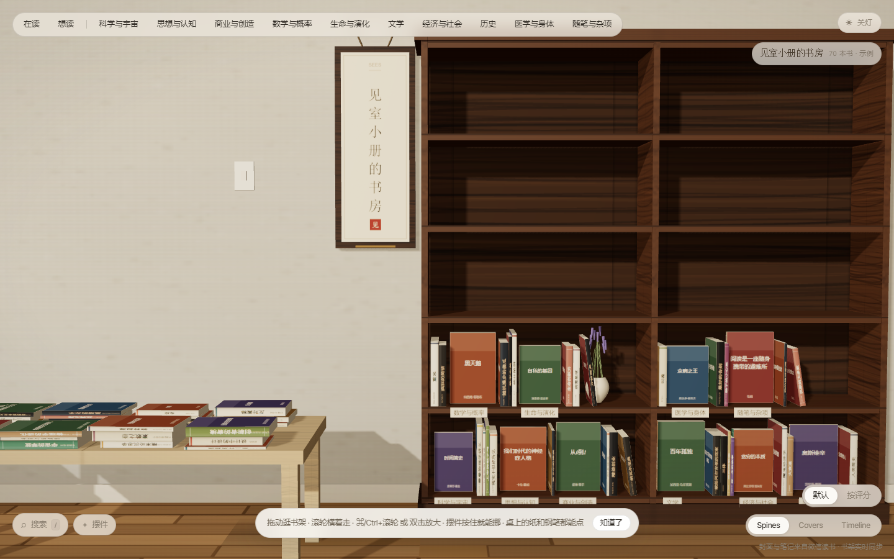
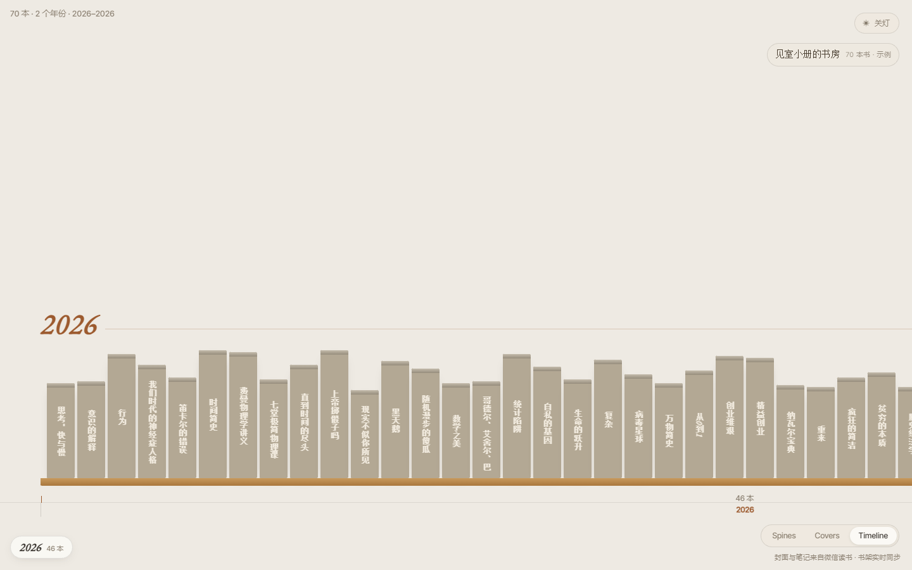

# 见室书架 · Weread Bookshelf

把微信读书的书架搬进一间可以走动、可以关灯、可以抽出一本书来读的 3D 书房。



- **三种视图**：`Spines` 密排书脊、`Covers` 封面墙、`Timeline` 按阅读年份排开的横向年表
- **真书、真笔记**：书、阅读进度、划线、想法、出版社信息都来自你自己的微信读书账号
- **一间屋子**：木书柜、两张矮桌（在读 / 想读）、墙上的开关、可以随手拖动的摆件、门口刻着名字的木牌
- **零运行时依赖**：只用 Node 内置模块 + 本地打包的 three.js，不联网也能开起来

> 这是**单用户自部署版**：Key 只放在服务端环境变量里，浏览器拿不到，也不存在「别人带自己的 Key 来开一间」的多租户逻辑。想要多用户，请自行 fork 改造。

---

## 跑起来

要求 **Node.js ≥ 20**（用到原生 `fetch`、ESM、top-level await）。

```bash
git clone https://github.com/daheitian/weread-bookshelf.git
cd weread-bookshelf
npm start
# → http://localhost:4599
```

没有 `npm install` 也能直接 `node server.mjs` —— 运行时不依赖任何第三方包。

第一次打开会看到内置的**示例书架**（几十本合成的书），用来先确认版面。换上自己的书：

```bash
cp .env.example .env
# 编辑 .env，填入 WEREAD_API_KEY=wrk-xxxxxxxx...
npm start
```

`WEREAD_API_KEY` 是微信读书 Agent 接口的 Key（`wrk-` 开头）。也可以不走 `.env`，直接给环境变量：

```bash
WEREAD_API_KEY=wrk-xxxx PORT=4599 node server.mjs
```

刷新 `/api/library?sync=1` 可强制重新同步。没配 Key、或 Key 失效时会自动回落到示例书架，不会白屏。

---

## 隐私与数据

| 位置 | 内容 | 是否进仓库 |
|---|---|---|
| `.env` | 你的 `WEREAD_API_KEY` | **否**，已被 `.gitignore` 排除 |
| `data/u/owner/` | 书架、进度、笔记缓存 | **否** |
| `data/covers/` | 封面代理的磁盘缓存 | **否** |

- Key 只在服务端使用，作为 `Authorization` 头发往微信读书接口；**不会下发到浏览器**，不写日志，不进任何 URL。
- 所有个人数据都写在本地 `data/`，没有外部数据库、没有遥测、没有第三方统计。
- 封面走 `/api/cover` 代理（微信读书 CDN 校验 referer，直连会 403），按 URL 的 sha1 落在磁盘上。

---

## 三种视图

| 视图 | 快捷键 | 说明 |
|---|---|---|
| **Spines** | `Esc` / `T` 退出年表 | 默认。密排高柜，书脊是按封面配色烘焙出来的 |
| **Covers** | 右下角切换 | 7 层宽格书报墙，整张封面朝外 |
| **Timeline** | `T` | 按 `addedAt / readAt / finishedDate` 的年份分组，横向拖拽浏览，底部年份轴可点跳 |

年表视图受 [Ben Tossell 的 books 页面](https://bentossell.com/books/) 启发：一年一段木隔板，书脊宽度与高度按每本书略有参差，`← / →` 跳年，悬停出卡片，点书直接翻开读者。深链 `?view=timeline`、`?view=covers` 可直接进入对应视图。



---

## 交互

- **拖动** 平移，**滚轮 / 双指捏合 / `+` `-`** 推近拉远，`0` 或 `H` 回整架，双击空白处复位
- **`← / →`** 平移（年表里是跳年）；**`↑ / ↓`**、**`PageUp / PageDown`** 上下搓书架
- **`/`** 搜索书名 / 作者 / 分类，回车飞到第一本命中
- **`L`** 关灯 / 开灯（墙上的拨杆开关也可以点）
- **`T`** 进 / 出年表，**`Esc`** 合上读者或退出年表
- **点书** 翻开：扉页、划线、想法、阅读进度、出版社信息，以及「在微信读书打开」
- 顶部胶囊跳到在读 / 想读那张桌子或某个分类；左下可以摆 24 种小摆件，拖动换位、选中后调尺寸

地址栏会跟着走，刷新、分享、后退都能回到同一处（`?view=`、`#reading`、`#cat-xxx`）。

---

## 接口

| 端点 | 作用 |
|---|---|
| `GET /api/library` | 书架数据，缓存 6 小时；`?sync=1` 强制同步 |
| `GET /api/progress?id=<bookId>` | 单本阅读进度，点开详情时按需取 |
| `GET /api/notes?id=<bookId>` | 划线、想法、书籍详情，缓存 3 天 |
| `GET /api/nb` | 哪些书有笔记、各几条 |
| `GET /api/cover?u=<url>` | 封面代理，带磁盘缓存 |
| `GET /api/status` | 是否已配置 Key、当前是真实书架还是示例 |

`/shelf/sync` 不返回阅读进度，进度要一本一本拉。500 本全量约 5～6 秒（10 并发），所以按「最近阅读时间」当版本号缓存进 `data/u/owner/progress.json`：书没被翻过就不再问，二次同步 0.5 秒内返回。

---

## 结构

```
weread-bookshelf/
├─ server.mjs              Node HTTP 服务：静态文件 + 接口 + .env + 封面磁盘缓存
├─ lib/weread.mjs          微信读书适配（shelf/sync、getprogress、bookmarklist、review、book/info）
├─ lib/demo.mjs            示例书架
├─ public/
│  ├─ index.html
│  ├─ style.css
│  ├─ fonts/               Inter Tight / EB Garamond / Ma Shan Zheng
│  └─ js/
│     ├─ three.module.js   three.js r169（本地打包，不走 CDN）
│     ├─ scene.js          房间、木作、相机、拾取、筛选、招牌、摆件
│     ├─ atlas.js          封面 / 书脊图集烘焙、配色提取
│     ├─ timeline.js       年表视图（DOM 2D 横向滚动）
│     ├─ icons.js          摆件图标
│     └─ app.js            启动、浮层、翻书 + 笔记、搜索、视图切换
├─ tests/timeline-test.mjs 年表端到端验收（18 项，桌面 + 移动）
├─ docs/                   截图
└─ data/                   【本地生成，不进仓库】
```

### 自测

```bash
npm install          # 只装 devDependency：playwright
npm start            # 终端 A
npm test             # 终端 B
```

测试会跑 18 项断言：视图切换、年份分组与轴刻度对齐、横向滚动、全部书渲染、方向键与点轴跳年、点书翻开读者、`Esc`/`T` 键、深链、390×844 移动端布局。若用 Edge 而非 Chromium：`BROWSER_CHANNEL=msedge npm test`；端口不同用 `BASE=http://localhost:4600 npm test`。

---

## 部署

`server.mjs` 是一个普通的长驻 Node HTTP 服务，直接跑在**本机、VPS、Docker、Railway / Render 这类支持长驻进程与本地磁盘的主机**上即可。需要持久化 `data/` 时挂载一个卷。

> Vercel / Netlify 的 Serverless Functions 不是长驻进程、磁盘也不可写，需要自己把 `server.mjs` 包一层 handler、并把 `data/` 换成外部存储。这一层不在本仓库范围内。

---

## 第三方

- [three.js](https://threejs.org/) r169 —— MIT，见 `public/js/three.module.js` 文件头
- [Inter Tight](https://fonts.google.com/specimen/Inter+Tight)、[EB Garamond](https://fonts.google.com/specimen/EB+Garamond)、[Ma Shan Zheng](https://fonts.google.com/specimen/Ma+Shan+Zheng) —— SIL Open Font License 1.1，随仓库附带 `woff2` 以便离线运行
- 视觉参考：[Ben Tossell · Books](https://bentossell.com/books/)（年表视图）、[chrija76/bookshelf](https://github.com/chrija76/bookshelf)

本仓库的代码以 **MIT** 协议发布，见 [LICENSE](LICENSE)。

> 本项目是个人把玩的作品，与微信读书官方无关。请遵守微信读书的服务条款，勿将接口用于公开商业服务。
